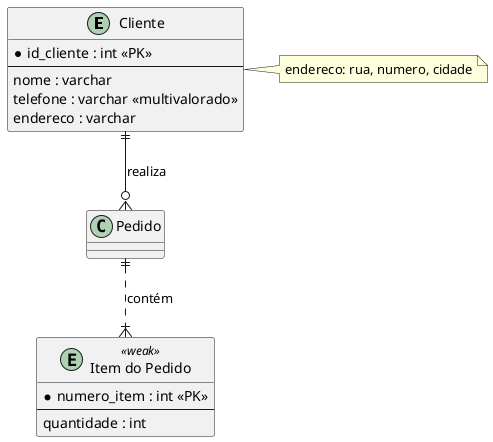

# Avaliador Automático de Diagramas ER em PlantUML

Ferramenta em Python para avaliar diagramas Entidade-Relacionamento (ER) gerados por LLMs, comparando cada diagrama com um **modelo de referência (gabarito)**. Tanto o gabarito quanto o diagrama avaliado são arquivos **PlantUML**, e os cenários são em **português**.

Foi desenvolvida para o trabalho *Análise do Impacto do Nível de Detalhamento de Prompts na Geração de Diagramas ER via LLMs para um Mesmo Cenário de Requisitos* e adapta o pipeline de avaliação de Ramachandran et al. (2025), baseado em *parsing* e comparação estrutural, estendendo-o com relacionamentos e cardinalidades.

## O que a ferramenta faz

1. Extrai o código PlantUML da resposta do LLM (ignora texto e cercas de markdown em volta).
2. Verifica se o código **compila** no PlantUML.
3. Converte o código em estruturas em memória: entidades, atributos e relacionamentos com cardinalidades.
4. Compara com o gabarito e atribui uma **nota percentual (0 a 100)**.
5. **Classifica as falhas**: omissões, erros de tipo, erros de cardinalidade e elementos extras (possíveis alucinações).
6. Salva o resultado de cada diagrama em `Resultado_do_<nome do arquivo>.txt`.
7. No modo lote, gera uma **tabela comparativa por LLM e nível de detalhamento** e arquivos CSV.

A comparação de nomes **não usa IA**: os nomes são normalizados (sem acento, sem maiúsculas, `_` vira espaço) e comparados por similaridade de strings (`difflib`). A ordem das palavras também é ignorada, então `id_cliente` e `cliente_id` são equivalentes.

## Arquivos

| Arquivo | Função |
|---|---|
| `avaliador_er.py` | A ferramenta (parser, avaliação, verificação de compilação, lote e relatórios) |
| `test_avaliador_er.py` | Testes de validação, com notas esperadas calculadas à mão |
| `gabarito_exemplo.puml` | Exemplo de gabarito |
| `LLM_exemplo.puml` | Exemplo de diagrama avaliado (resposta de LLM com erros propositais) |

## Requisitos

- **Python 3.8+**. Não há dependências externas.
- **Java**, usado só para a verificação de compilação.
- **`plantuml.jar`**, o compilador do PlantUML. Baixe em <https://plantuml.com/download> ou direto em <https://github.com/plantuml/plantuml/releases/latest/download/plantuml.jar>.

Se o arquivo baixado tiver a versão no nome (por exemplo `plantuml-1.2026.1.jar`), renomeie para exatamente `plantuml.jar` e deixe-o na pasta de onde você roda o comando. Confira com:

```
java -jar plantuml.jar -version
```

O script localiza o PlantUML nesta ordem:

1. opção `--plantuml "CMD"`;
2. variável de ambiente `PLANTUML_CMD`;
3. comando `plantuml` no PATH;
4. `plantuml.jar` na pasta atual ou o caminho em `PLANTUML_JAR` (usa `java -jar`).

Se não achar, o script avisa e **segue sem verificar a compilação**.

## Uso rápido

### Avaliar um diagrama

```
python avaliador_er.py gabarito.puml resposta.puml
```

Imprime o relatório no terminal e o salva em `Resultado_do_resposta.txt`, na mesma pasta de `resposta.puml`.

### Avaliar um experimento completo (lote)

Organize as respostas dos LLMs assim (os nomes das pastas viram as colunas *LLM* e *Nível* da tabela):

```
resultados/
  ChatGPT/detalhado/exec1.puml, exec2.puml, ...
  ChatGPT/simplificado/exec1.puml, ...
  Claude/detalhado/...
  Gemini/simplificado/...
```

```
python avaliador_er.py gabarito.puml --lote resultados/ --saida experimento
```

Gera:

- a tabela comparativa no terminal;
- `Resultado_do_<arquivo>.txt` ao lado de cada diagrama avaliado;
- `experimento_detalhado.csv` (uma linha por execução);
- `experimento_resumo.csv` (uma linha por LLM e nível).

Os arquivos `Resultado_do_*.txt` não são lidos como entrada, então o lote pode ser executado de novo sem problema. Evite nomear respostas de LLM começando com `Resultado_do_`. São aceitas as extensões `.puml`, `.plantuml`, `.pu`, `.txt` e `.md`.

### Opções

| Opção | Efeito |
|---|---|
| `--limiar 0.85` | Similaridade mínima para dois nomes serem considerados equivalentes (padrão `0.85`) |
| `--plantuml "CMD"` | Comando do PlantUML, por exemplo `"java -jar C:\caminho\plantuml.jar"` |
| `--sem-compilar` | Não verifica a compilação |
| `--pontuar-sem-compilar` | Pontua também os diagramas que não compilam (por padrão ficam sem nota) |
| `--saida PREFIXO` | Grava os CSVs do lote com esse prefixo |
| `--json` | Saída em JSON no modo de um diagrama |

## Formato PlantUML aceito



| Conceito | Como escrever |
|---|---|
| Entidade | `entity Nome { ... }` ou `entity "Nome Composto" as Alias { ... }` |
| Entidade fraca | `<<weak>>` ou `<<fraca>>` na linha da entidade |
| Atributo identificador | `<<PK>>` (também `<<chave>>`) |
| Atributo multivalorado | `<<multivalorado>>` ou `<<multi>>` |
| Atributo composto | nota `note right of Entidade` (ou `left of`) com linhas `composto: sub1, sub2` |
| Chave estrangeira | `<<FK>>` (é lida, mas **não pontua**) |
| Relacionamento | `A ||--o{ B : nome`, com notação pé-de-galinha |
| Relacionamento fraco | conector com `..` em vez de `--` |

Cardinalidades reconhecidas: `||` (1..1), `o|` (0..1), `|{` (1..N) e `o{` (0..N). O lado esquerdo é escrito espelhado (`}o` equivale a `o{`). O sentido em que o relacionamento é escrito não importa: `A ||--o{ B` equivale a `B }o--|| A`.

Se os seus diagramas usarem outra convenção, o ajuste fica em `_parse_atributo` e na parte de notas de `PlantUMLParser.parse`.

## Como a nota é calculada

Cada **entidade** e cada **relacionamento** do gabarito é uma unidade, com peso `PESO_ENTIDADE` e `PESO_RELACIONAMENTO` (padrão 1 e 1). A nota é a soma dos pontos obtidos dividida pela soma dos pesos, em %.

**Entidade** (Algoritmo 2 do artigo). Só pontua se houver entidade correspondente no diagrama avaliado (similaridade ≥ limiar). Os pontos se dividem em *(nº de atributos + 1)* componentes iguais:

- 1 componente pelo tipo da entidade (forte ou fraca) igual ao do gabarito;
- 1 componente por atributo do gabarito encontrado, valendo a fração de acertos entre **identificador**, **multivalorado** e **composto**. Um atributo *simples* acerta quando nenhuma das três características foi marcada.

**Relacionamento.** Só pontua se as duas entidades tiverem correspondência e existir relacionamento entre elas. Metade dos pontos vem da identificação do relacionamento e a outra metade da cardinalidade (metade para cada lado).

Cada atributo do diagrama avaliado só pode corresponder a um atributo do gabarito.

**Exemplo:** gabarito com 3 entidades e 2 relacionamentos = 5 unidades de 20 pontos. Um diagrama sem uma das entidades perde os 20 pontos dela e também os do relacionamento que dependia dela.

### Classificação das falhas

| Categoria | Tipos registrados |
|---|---|
| Omissões | entidade, atributo ou relacionamento do gabarito ausente |
| Erros de tipo | entidade forte/fraca trocada; atributo com tipo incorreto |
| Erros de cardinalidade | cardinalidade incorreta ou **invertida** |
| Extras (possíveis alucinações) | entidade, atributo ou relacionamento sem correspondência no gabarito |

Um elemento extra pode ser só um sinônimo com similaridade abaixo do limiar. Por isso a ferramenta o chama de *possível* alucinação.

## Saídas

**`Resultado_do_<arquivo>.txt`**: cabeçalho (arquivo, gabarito, limiar) seguido do relatório: compilação, nota final, pontos por entidade, atributo e relacionamento, e lista de falhas.

**`<prefixo>_detalhado.csv`**: `arquivo, llm, nivel, compilou, interpretavel, nota, omissoes, erros_tipo, erros_cardinalidade, extras, erro`

**`<prefixo>_resumo.csv`** e tabela do terminal: por LLM e nível, nº de execuções, taxa de compilação, nº avaliadas, nota média, desvio padrão, mínimo, máximo e média de falhas por diagrama em cada categoria.

### Diagramas que não compilam ou não são interpretáveis

- Se não compila: fica **sem nota** e conta só na taxa de compilação (use `--pontuar-sem-compilar` para pontuar mesmo assim).
- Se compila, mas o *parser* não consegue interpretar (por exemplo, relacionamento com entidade inexistente): fica sem nota e o motivo vai no relatório e no CSV.

## Testes

```
python -m unittest -v test_avaliador_er
```

Para incluir o teste com o PlantUML real, deixe o `plantuml.jar` na pasta ou defina `PLANTUML_JAR`. Sem ele, esse teste é pulado. Os demais usam um compilador falso e não precisam de Java.

Com os arquivos de exemplo, o resultado esperado é:

```
python avaliador_er.py gabarito_exemplo.puml aluno_exemplo.puml
→ NOTA FINAL: 82.00%
```

## Uso como biblioteca

```python
import avaliador_er as ae

gab = ae.PlantUMLParser.parse(ae.extrair_plantuml(ae.ler_arquivo_puml("gabarito.puml")))
ex = ae.avaliar_diagrama(ae.ler_arquivo_puml("resposta.puml"), gab, ae.Config(verificar_compilacao=False))
print(ex.resultado.nota)
```

## Limitações e decisões de projeto

- Os pesos de entidades e relacionamentos e a divisão dos pontos do relacionamento (metade identificação, metade cardinalidade) não são fixados pelo artigo de referência. Os valores padrão são uma escolha deste projeto e podem ser alterados no início de `avaliador_er.py`.
- Chave estrangeira não pontua, pois a proposta avalia atributos simples, identificadores, multivalorados e compostos. Para pontuá-la, acrescente `"fk": lambda a: a.eh_chave_estrangeira` em `RESTRICOES_ATRIBUTO`.
- O nome do relacionamento não é pontuado, apenas as entidades ligadas e as cardinalidades.
- A correspondência de entidades é gulosa (para cada entidade do gabarito, escolhe-se a mais parecida ainda não usada), como no Algoritmo 2 do artigo.
- A similaridade é lexical (string). Sinônimos como `Cliente` e `Comprador` não são reconhecidos.

## Referência

RAMACHANDRAN et al. *AI Assisted System for Automated Evaluation of ER Diagram and Schema Diagram Using LLMs*. Big Data and Cognitive Computing, 2026, 10, 2. DOI: 10.3390/bdcc10010002.
